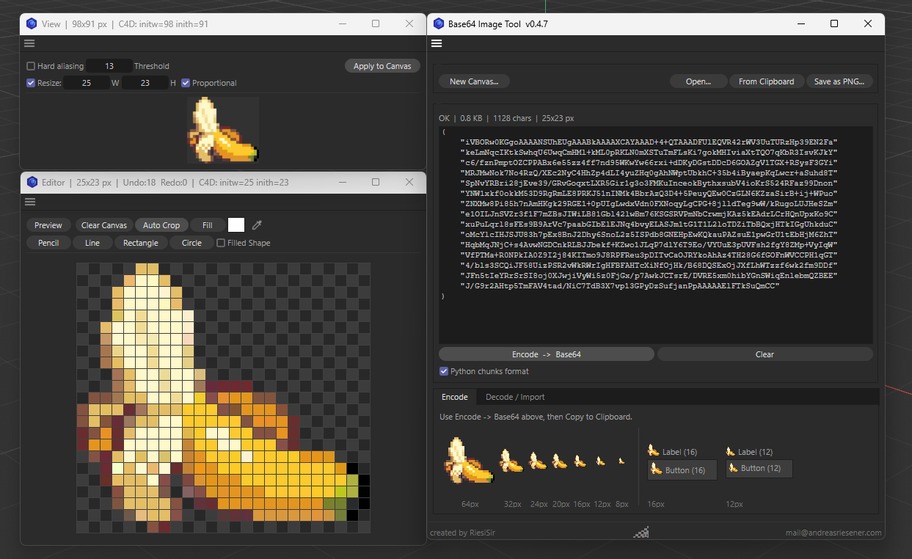
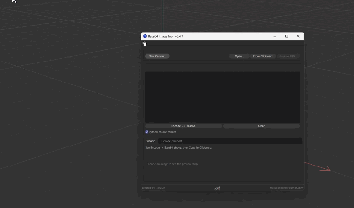

# Base64 image tool

Base64 encoding converts binary image data into ASCII text using a specific alphabet of 64 characters. 
This transformation allows images to be represented as text strings that can be embedded directly into scripts as C4D dialog graphics.

Main focus of this tool is for optimiazation of Picture to Base64 code, but it has also a small editor with some capabilities.
C4D has an own Base64 Generator underneath it's belly. Somehow online converter didn't work for me.

So, why generating Code somewehre else to use in C4D Dialogs, than directly in C4D itself :)

## Requirements

* Cinema 4D 2025+

## Installation

1. Paste Script in C4D Script Manager
2. run only once or save script as you like

## Features

Open/Save:
- Open Images from drive direct to the editor
- From Clipboard (screenshot [win+shift+s] what you like and load it)
- Save as PNG (also good for backups)
- New Canvas to start fresh

Preview:
- Hard aliasing: usefull for loaded images with alpha
- Resize: resamples the image.
- Apply to canvas: applies these settings to the canvas. The canvas is the full truth.

Editor:
- Preview: opens a semi-live preview (updates after every mouse release) with filters and the alpha is correct applied in the UI.
- Clear Canvas: deletes every pixel in the canvas
- Auto Crop: Trims Canvas to visible pixels
- Fill: left click --> Fills with color, right click --> clears area (like simple wand)
- Pencil: left click --> draws pixel, right click --> erasing
- Line/Rectangle/Circle: left click --> draws pixel, right click --> earasing
- Filled shapes: fills Rectangle and Circle while creating.
- Color and Color Picker: From C4D System, be aware of missmatch colors, because ACES color management is still not fully implemented.
- undo/redo: only in the editor via cmd+z/cmd+y, 50 steps limit 

Encode:
- press to generate the code and get some previews in different size underneath it
- Pyhton chunks format: If checked (by default) it splits the codes in also readable chunks (C4D conform)
----> If not checked you get a Base64 typical one liner (clipboards and other stuff have a lot issues with this to load)

Decode/Import:
- If you have already a Base64 (C4D conformed) you can paste it here and load it in the editor.

## Screenshot

## License

MIT License

