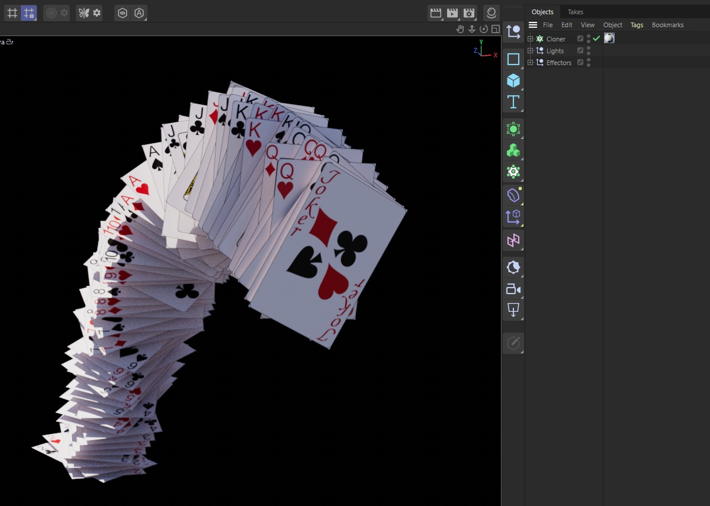
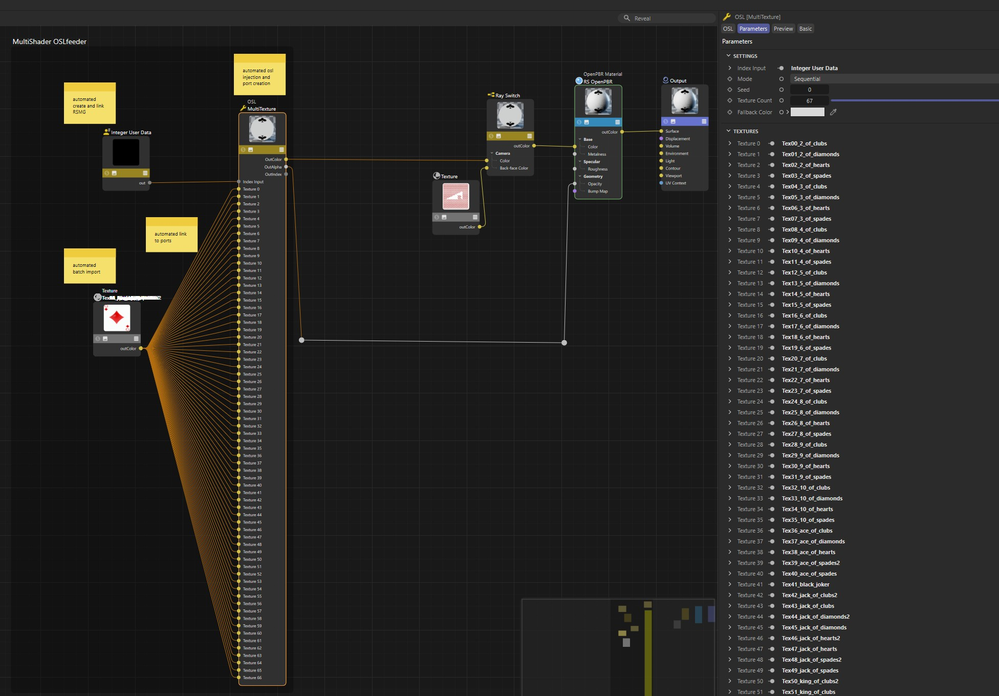

# RS MultiShader OSLfeeder

A workaround script to achieve similar system like the multishader (only working in the old shader graph) for the node editor.
It batch imports images from a selected folder and writes all necessary ports in the OSL and connects them all.

## Requirements

* Cinema 4D 2025+

## Installation

1. Paste Script in C4D Script Manager
2. run only once or save script as you like

## Usage

Create/Select a OSL Shader ---> run the script ---> choose image folder
Modes: sequential/random

By default it creates also an USER DATA with RSMG as Index Input. This drives by default a cloner system, but can be changed with another USER DATA of your own choosing.

## Screenshot

## License

MIT License

