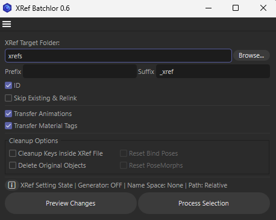
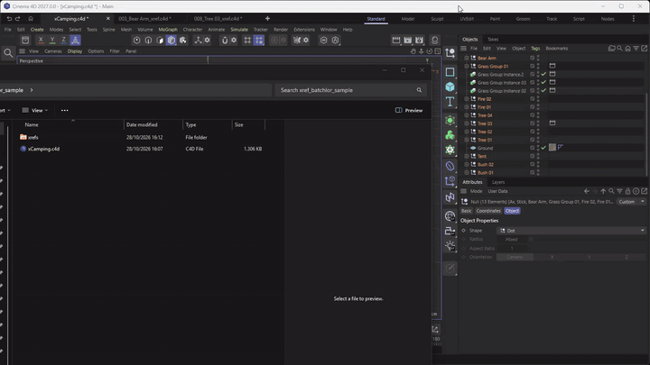
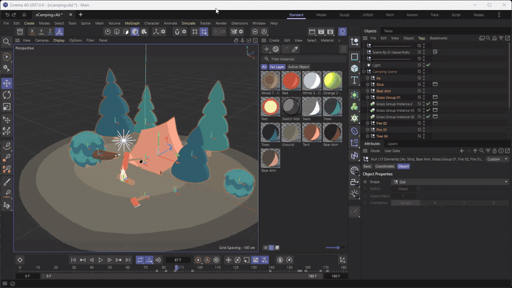

# xref batchlor

It is an automated pipeline for converting scene hierarchies into modular XRef assets with full data parity. Designed for better Asset Management and Performance.

## Requirements

* Cinema 4D 2025+

## Installation

1. Paste .py Script in C4D Script Manager
2. run only once or save script as you like

or

1. Place .pyp File in the plugins folder
2. run from extension menu

## Features & Logic

- Recursive Animation Mirroring:

Unlike native C4D XRef behaviors, this tool clones all CTracks from the source hierarchy to the XRef container.
Supports animation on Objects and all associated Tags (Materials, Constraints, etc.).
Preserves animation timing and interpolation by deep-cloning tracks into the master scene.

- Top-Level Selection Filtering:

Automatically filters user selection to identify "Root" objects.

Only processes objects whose parents are not part of the selection. This prevents redundant nested XRef creation and maintains a clean master hierarchy.

- Transform Decoupling (PSR Neutralization):

Export: The root object inside the generated .c4d file is neutralized (Local Matrix = Identity).

Import: The original global PSR data is transferred to the XRef Container in the master scene.

Logic: The XRef container becomes the new parent. This ensures the master scene controls the asset's placement while the external file remains clean for modular use.

- ID Indexing:

Folder-aware indexing via Regex (^(\d+)_).
Detects the highest numeric prefix in the target directory on execution.
Maintains chronological file ordering across multiple work sessions.
Relinking (Skip Export):

Performs a strict Name+Suffix check (stripping ID prefixes) before writing to disk.
If a match exists, it bypasses the export to save I/O but still instantiates the XRef object and binds it to the existing asset.

- Recursive Material Tag Mirroring:

Optional Reconstructs the material tag stack on the XRef container.
Handles material assignment to ensure the modular XRef renders identically to the original geometry.

- Internal Optimization:

NoXref Layer: Generates a hidden layer in the exported file to manage helper objects and material links without cluttering the master scene.

Keyframe Sanitization: Optional routine to strip internal keyframes in the external file to reduce file size and loading times.

- skip + relink:

If files with the same name already exist of the selected objects, it can be relinked. Multiple animations with one source xref are possible this way i.e. character animations.

- Reset Bind Poses + PoseMorphs:

For simple character assets like i.e. motion captures

- Preview Data check:

You can check naming and correct actions (new, relink, overwrite) before starting a batch process

- supported undo/redo:

No one way action. If something doesn't sit right, just undo.

- Info Stats:

Process and final Statistics (How much Objects are found, skipped, overwritten, linked) in the C4D info line (bottem left corner of C4D UI)

## UI

## Demonstrations

## License

MIT License

